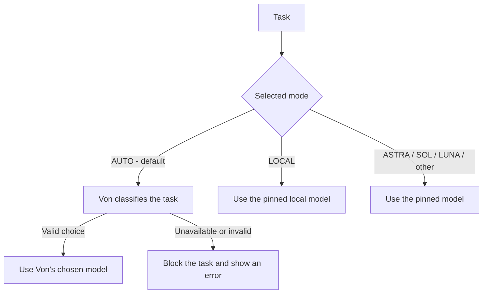

# pi-router

Automatic model routing for [Pi](https://github.com/earendil-works/pi). Users configure a set of models from any Pi provider; Von classifies each task among those candidates, and pi-router switches Pi to the selected model.

For example, AUTO can choose among a local model, Luna for lightweight work, Sol for everyday coding, and ASTRA for difficult reasoning. Models from other providers work through the same configuration. No provider or model name requires a source-code change.

> **Experimental / Personal Project**
>
> This experimental personal project may change significantly and may not cover every use case. Use it as a starting point and adapt it for your workflow.

## Architecture



Pi owns provider connections, credentials, tools, and task execution. Von classifies the task; it does not execute it. AUTO requires a valid decision from Von for every new task and follows that choice directly. An unavailable, disabled, invalid, or timed-out classifier blocks the task before execution. There is no automatic fallback to LOCAL, another target, or a previous task's decision.

Manual modes bypass Von entirely. `/local`, `/astra`, `/sol`, `/luna`, or another configured model command pins that model for all tasks until the user changes mode. Provider failures do not switch a manual model automatically.

## Requirements

- Node.js 22.19 or later and the Pi host (`@earendil-works/pi-coding-agent`).
- Models configured in Pi, with their provider credentials where required.
- A separately installed [Von server](https://github.com/wfzyx/von) and its model weights for AUTO classification.

The extension has no npm runtime dependencies of its own. Installing it does not install Von, download model weights, create model backends, or supply API credentials. Von is a separate open-source project maintained by its own authors.

## Configure routing targets

Copy [router.config.example.json](./router.config.example.json) to `router.config.json` beside `index.ts`, or point `PI_ROUTER_CONFIG` at a JSON file elsewhere. The file is ignored by Git.

```json
{
  "targets": [
    {
      "id": "luna",
      "name": "Luna",
      "provider": "openai",
      "model": "gpt-6-luna",
      "description": "Quick, simple edits, short explanations, and lightweight tasks."
    },
    {
      "id": "sol",
      "name": "Sol",
      "provider": "openai",
      "model": "gpt-6-sol",
      "description": "General coding, implementation, debugging, and everyday reasoning."
    },
    {
      "id": "astra",
      "name": "ASTRA",
      "provider": "openai",
      "model": "gpt-6-astra",
      "description": "Complex architecture, deep reasoning, security analysis, and persistent failures."
    },
    {
      "id": "other",
      "name": "Another provider",
      "provider": "my-provider",
      "model": "my-model-id",
      "description": "Tasks requiring this model's specialized capabilities."
    }
  ]
}
```

Provider and model IDs above are examples, not a guarantee that a service offers them. Use the exact provider and model IDs from **your Pi model registry**. A custom or OpenAI-compatible provider is supported once configured in Pi. Routing configuration contains references to models, not endpoint definitions or credentials. Pi must expose each target as a chat model capable of task execution; classifier-only or image models cannot run coding-agent turns.

Each target requires:

| Field         | Purpose                                                                      |
| ------------- | ---------------------------------------------------------------------------- |
| `id`          | Stable lowercase alias, such as `sol`, used in commands and saved sessions.  |
| `name`        | Optional display label; defaults to the uppercase alias.                     |
| `provider`    | Exact Pi provider ID.                                                        |
| `model`       | Exact model ID within that provider.                                         |
| `description` | Tasks this model should handle; sent to Von as its classification criterion. |

Aliases must match `[a-z][a-z0-9_-]*`. `auto`, `router`, `manual`, `models`, and `uncertain` are reserved. Aliases and provider/model pairs must be unique. The router rejects invalid configuration visibly at load time.

AUTO is always the default mode for a new session. Legacy `defaultTarget` and `reasoningTarget` settings are ignored; there is no model fallback in AUTO.

Without a routing configuration file, the original `local/model` and `openai/gpt-6-astra` targets remain the defaults. Neither LOCAL nor ASTRA is required in a custom list. Reload the extension or restart Pi after changing configuration.

## Configure Von

Follow [Von's installation instructions](https://github.com/wfzyx/von), download its weights, and start its service, for example:

```bash
von serve --host 127.0.0.1 --port 8100 --device cpu
```

Create a local Von configuration and set `PI_ROUTER_VON_CONFIG` to its path, or edit `von.config.json` beside the extension:

```json
{
  "url": "http://127.0.0.1:8100",
  "enabled": true,
  "timeoutMs": 5000
}
```

Von is enabled in the bundled configuration. Start its service before using AUTO. Setting `enabled` to `false` blocks AUTO tasks; manual modes still work. Warm the service with a real classification request before relying on a short request timeout; an HTTP health response alone does not prove weights are loaded.

Von receives uppercase target aliases as options (`LUNA`, `SOL`, `ASTRA`, etc.) and each target's description as its criterion. It also receives a compact task snapshot, attempt counts, failure signals, and the current target. Optional `criteria` entries in the Von configuration override descriptions by uppercase alias.

Von owns model selection. The router uses the response's `choice` exactly, including when confidence is low, probabilities tie, or another candidate has a higher reported probability. Probabilities and confidence are retained for diagnostics; they never cause the router to replace a valid choice with LOCAL or another target. The old `clearChoiceThreshold` and `clearAstraThreshold` settings are obsolete and ignored.

A missing or malformed decision blocks AUTO. An unavailable chosen model or rejected Pi model switch also blocks the task. Restore Von/model availability and resubmit the task, or explicitly select a manual mode. The router never substitutes another model.

Only targets present in Pi's registry with configured authentication are offered to Von. This checks configuration, not service reachability, model quality, quota, or credential validity at the provider.

## Load the extension

Add the actual extension file to Pi's settings:

```json
{
  "extensions": ["/absolute/path/to/orq-pi-router/index.ts"]
}
```

Or load it directly:

```bash
PI_ROUTER_CONFIG=/absolute/path/to/router.json \
PI_ROUTER_VON_CONFIG=/absolute/path/to/von.json \
pi -e /absolute/path/to/orq-pi-router/index.ts
```

Keep provider credentials in Pi's normal secure provider configuration. Never put keys in target descriptions, source files, or routing configuration.

## Commands and manual selection

| Command                  | Behavior                                                        |
| ------------------------ | --------------------------------------------------------------- |
| `/auto`                  | Default mode; require Von to choose the model for each task.    |
| `/local`                 | Pin LOCAL for every task, bypassing Von.                        |
| `/astra`                 | Pin ASTRA for every task, bypassing Von.                        |
| `/sol`, `/luna`, `/<id>` | Pin the configured model for every task, bypassing Von.         |
| `/router <id>`           | Equivalent manual selection for any configured target.          |
| `/router`                | Show the current mode, selected model, and last decision/error. |
| `/router models`         | List configured models and availability.                        |

Each configured alias gets a direct slash command. Aliases that conflict with Pi's built-in commands, such as `model`, remain accessible through `/router <id>` so the existing Pi command keeps working. `/local` and `/astra` report an unknown target if those aliases are absent from a custom list.

Pi's `/model` selector still contains the registered provider models plus a virtual AUTO entry. Selecting any real model pins it, including models outside the routing target list. Select AUTO or run `/auto` to resume automatic routing. A failed model switch does not commit a new routing target or manual mode.

## Failure handling and session state

In AUTO, failure counters and task context are sent to Von for its decision. The router does not rotate models or use keyword rules after failures. If Von cannot classify a new task, the task is blocked. Each new task gets a fresh classification; continuing tool turns for an already-classified task retain that task's selection.

One AUTO task may wait while a task is running. An additional submission is rejected until that queued task starts, so its Von selection cannot be overwritten.

In a manual mode, every task stays on the selected model, including after errors. The user explicitly chooses another model or `/auto` to change this. Successful turns reset the failure streak; cancellation and context-window overflow do not count as ordinary provider failures.

Routing state is persisted as Pi custom session entries, including target aliases, mode, failure counters, decision counters, and switch history. Removed target aliases are cleared on restoration. The router does not persist prompts as part of routing state. When Von is enabled, the compact task snapshot is sent to its configured endpoint; provider requests follow each provider's privacy rules.

## Development

Source files are `index.ts` (Pi integration), `targets.ts` (target configuration), and `von.ts` (classifier adapter and policy).

Run the checked-in tests with Node.js 22.19 or later:

```bash
npm test
```

To check routing only, without ASTRA, Sol, Luna, or any other task-model API keys:

```bash
npm run test:routing
```

These tests stop after the router selects a provider/model through `setModel()`. The full pipeline test feeds tasks through the real Von HTTP adapter, response parser, and routing policy against a local classifier fixture. It checks LOCAL, LUNA, SOL, and ASTRA selections and rejects any attempted task-provider HTTP request. Classifier responses and the Pi model registry are controlled fixtures, so no Von installation, model weights, credentials, or task execution is needed.

For a **real Von classifier** with the same stop-at-selection boundary:

```bash
# Start Von separately and load/warm its weights first.
npm run test:von
```

This opt-in check uses the actual Von server at `http://127.0.0.1:8100` and a mock Pi registry/selection boundary. Override `PI_ROUTER_TEST_VON_URL` for a different server or `PI_ROUTER_TEST_VON_TIMEOUT_MS` for a different timeout (default: 15000). It requires no task-model keys and never calls their APIs. A missing, malformed, or timed-out Von response fails the check; a missing classification never counts as a live routing pass. The test reports the selected target for each task and verifies response-to-model mapping; it does not assert that a particular model is semantically best for that task.

To evaluate whether very demanding tasks actually route to the configured highest-capability target:

```bash
npm run test:von:hard
```

This opt-in suite uses eight descriptions in `tests/fixtures/high-intelligence-tasks.json`, covering consensus proofs, cryptographic protocol analysis, weak-memory concurrency, Byzantine finality, causal identification, numerical stability, cross-layer incident diagnosis, and authorization noninterference. Each case expects `astra` under its configured role and stops at model selection. It uses the same real Von server and no task-model keys. Unlike the basic integration check, this suite fails when a task reaches the wrong capability tier. The measured results, including direct agreement with Von and expected capability-tier selection, are documented in [VON_INTEGRATION.md](./VON_INTEGRATION.md).

The default `npm test` suite covers routing, configuration validation, direct Von-choice authority, HTTP protocol, manual selection, failed switches, blocked AUTO inputs, manual pinning, and legacy target references. It excludes the opt-in live Von check. Validate real task execution separately only when that becomes part of your test scope.

## License

MIT; see [LICENSE.md](./LICENSE.md).
