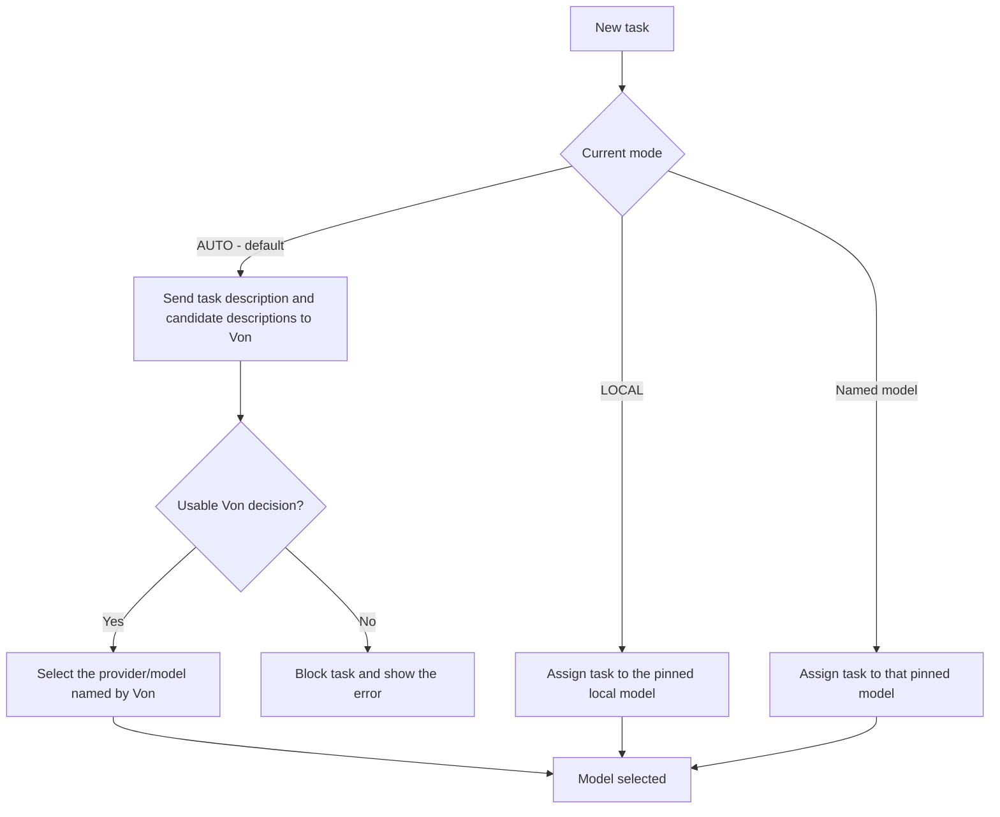

# orq-pi-router

A configurable model router for Pi. The user selects a routing mode; in AUTO, Von decides which model receives each task.

## 1. Core contract

| Mode                                                   | Who selects the task model?       | Is Von required? | Duration                                          |
| ------------------------------------------------------ | --------------------------------- | ---------------- | ------------------------------------------------- |
| `/auto` — default                                      | Von                               | Yes              | Until the user changes mode                       |
| `/local`                                               | The user, by selecting LOCAL      | No               | Every task stays on LOCAL until mode changes      |
| `/astra`, `/sol`, `/luna`, or another configured model | The user, by selecting that model | No               | Every task stays on that model until mode changes |

AUTO is the default for a new session. A resumed session restores its saved routing mode.

**Von owns model selection in AUTO.** The router applies Von's valid `choice` directly. It does not impose probability thresholds, re-rank the probabilities, or replace the choice with LOCAL.

**Manual selection bypasses Von.** Task complexity, classifier availability, and repeated provider errors do not automatically change a pinned model.

## 2. Logic gate



For routing-only tests, **the test ends at “Model selected.”** No task-model inference request follows.

## 3. Mode commands

| Command          | Effect                                                            |
| ---------------- | ----------------------------------------------------------------- |
| `/auto`          | Require Von to select the model for each new task.                |
| `/local`         | Pin the configured LOCAL model.                                   |
| `/astra`         | Pin the configured ASTRA model.                                   |
| `/sol`           | Pin the configured Sol model.                                     |
| `/luna`          | Pin the configured Luna model.                                    |
| `/<id>`          | Pin another configured target.                                    |
| `/router <id>`   | Select the same target through the generic command.               |
| `/router`        | Display mode, selected target, counters, and last decision/error. |
| `/router models` | List configured targets and their availability.                   |

Direct model commands are created from configured target aliases. If an alias conflicts with a Pi built-in command, use `/router <id>` instead. `/local` and `/astra` report an error when their target is absent from the configuration.

Pi's existing `/model` selector remains available. Selecting a real model pins it, including a model outside the router's target list. Selecting AUTO or running `/auto` resumes Von routing.

## 4. Configurable models and providers

A target is a named reference to a model already configured in Pi:

```json
{
  "targets": [
    {
      "id": "local",
      "name": "LOCAL",
      "provider": "local",
      "model": "model",
      "description": "Routine tasks suitable for the local model."
    },
    {
      "id": "luna",
      "name": "Luna",
      "provider": "openai",
      "model": "gpt-6-luna",
      "description": "Quick, simple edits, short explanations, and lightweight tasks."
    },
    {
      "id": "sol",
      "name": "Sol",
      "provider": "openai",
      "model": "gpt-6-sol",
      "description": "General coding, implementation, debugging, and everyday reasoning."
    },
    {
      "id": "astra",
      "name": "ASTRA",
      "provider": "openai",
      "model": "gpt-6-astra",
      "description": "Complex architecture, deep reasoning, security analysis, and persistent failures."
    },
    {
      "id": "other",
      "name": "Another provider",
      "provider": "my-provider",
      "model": "my-model-id",
      "description": "Tasks matching this model's specialized capabilities."
    }
  ]
}
```

These provider/model IDs are examples. Use the exact IDs offered by your provider and registered in Pi. Each target must be a chat/task model; a classifier-only model cannot execute a coding-agent task. An alias such as `luna` can reference whichever task-capable model your provider exposes.

Save the file as `router.config.json` beside the extension, or select an external file with `PI_ROUTER_CONFIG`. Reload Pi after editing it.

- `id`: unique lowercase alias matching `[a-z][a-z0-9_-]*`.
- `name`: optional display label; defaults to the uppercase alias.
- `provider` and `model`: the exact Pi registry reference.
- `description`: the tasks this target should handle, supplied to Von as a classification criterion.

Aliases `auto`, `router`, `manual`, `models`, and `uncertain` are reserved. Duplicate aliases and duplicate provider/model pairs are rejected.

Without a custom file, the target list contains `local/model` and `openai/gpt-6-astra`. A custom list can replace those targets entirely.

Pi manages endpoints and authentication. Routing configuration contains no credentials. In production, AUTO offers Von only targets present in Pi's registry with configured authentication.

## 5. Von configuration and decision flow

Von runs as a separate service. The router's default client configuration is:

```json
{
  "url": "http://127.0.0.1:8100",
  "enabled": true,
  "timeoutMs": 5000
}
```

The request model defaults to `von-latest`. Select a local client configuration through `PI_ROUTER_VON_CONFIG`, or use `von.config.json` beside the extension.

For every new AUTO task:

1. Check that Von is enabled and at least one configured target is available.
2. Build a compact snapshot containing the task description, current target, attempts, failure signals, and security-sensitive flag.
3. POST to Von's `/v1/systemone` endpoint with uppercase target aliases as options and target descriptions as criteria.
4. Validate that Von selected an offered option and returned finite probabilities between 0 and 1 for exactly those options.
5. Map Von's `choice` to the configured provider/model.
6. Await Pi's model switch and record the selection only if Pi accepts it.

For example, this valid result selects **ASTRA**, even though its probability is below 50%:

```json
{
  "choice": "ASTRA",
  "probabilities": {
    "LOCAL": 0.2414,
    "LUNA": 0.1574,
    "SOL": 0.2204,
    "ASTRA": 0.3808
  },
  "confidence": 0.1394
}
```

The router follows `choice` even if probabilities tie, confidence is low, or another probability is higher. Those values are diagnostic metadata; Von remains the decision maker.

## 6. Required failure behavior

In AUTO, block the task and show an actionable error when:

- Von is disabled, unreachable, or timed out.
- Von returns an invalid or unknown choice or malformed response.
- No configured task model is available.
- Pi rejects the selected model switch.

Do not execute the task on a previous model, choose LOCAL automatically, use keyword routing, or rotate models after repeated failures. The user can restore the required service/model and resubmit, or explicitly select a manual mode.

Manual modes continue to work with Von disabled or offline. Provider failures leave the manual selection unchanged.

The old `clearChoiceThreshold`, `clearAstraThreshold`, `defaultTarget`, and `reasoningTarget` settings are ignored.

## 7. Task lifetime and saved state

- Each new AUTO submission needs a fresh Von decision, including repeated task text.
- Continuing tool turns retain the selection already made for the active task.
- A manual mode change made while classification is in flight takes precedence.
- One AUTO task may wait while another task runs. Additional AUTO submissions are rejected until that queued task starts, preserving its selected model.
- Session state stores mode, target alias, counters, and switch history. It does not store task prompts as routing metadata.
- Restoring a session does not itself classify a new task. Removed aliases are cleared; a fresh session starts in AUTO.

## 8. Tests without task-model API keys

Run from the repository root with Node.js 22.19 or later:

```bash
# All deterministic checks; no Von service or task-model keys required.
npm test

# Routing-only checks, ending at model selection.
npm run test:routing

# Real, warmed Von; still no task-model API keys or provider requests.
npm run test:von

# Real Von with demanding tasks expected to choose ASTRA.
npm run test:von:hard
```

Deterministic tests use a mock Pi registry and controlled classifier responses. Live tests use real Von with a mock Pi model-selection boundary. No ASTRA, Sol, Luna, or other task-model API key is needed for this test scope.

Recorded validation:

- **40 deterministic tests pass**, including **29 routing tests**.
- Strict type checking passes against the installed Pi 1.3.0 API.
- An actual Pi process defaults to AUTO and blocks an AUTO task when Von is disabled.
- The same Pi process accepts `/luna` and `/sol` manual selections with Von disabled.
- Real Von basic routing checks pass and end at model selection.
- In the recorded demanding-task evaluation, **8/8 selections matched Von**, but only **1/8 selected the expected ASTRA tier**. The cryptographic task selected ASTRA; the other seven selected LOCAL. Classification quality remains an unresolved limitation.

See `VON_INTEGRATION.md` for task descriptions and measured probabilities.

## 9. Implementation map

| File                         | Responsibility                                                                  |
| ---------------------------- | ------------------------------------------------------------------------------- |
| `index.ts`                   | Mode gate, Pi events, commands, selection, task blocking, and session state.    |
| `targets.ts`                 | Configurable target loading and validation.                                     |
| `von.ts`                     | Task snapshot, Von HTTP client, response validation, and direct choice mapping. |
| `router.config.example.json` | Example model/provider target list.                                             |
| `von.config.json`            | Default Von client settings.                                                    |
| `tests/`                     | Deterministic, HTTP integration, mode-gate, and opt-in live tests.              |

This Markdown file describes the router's behavior and configuration. Pi runs the TypeScript extension; the document is not an executable router.
